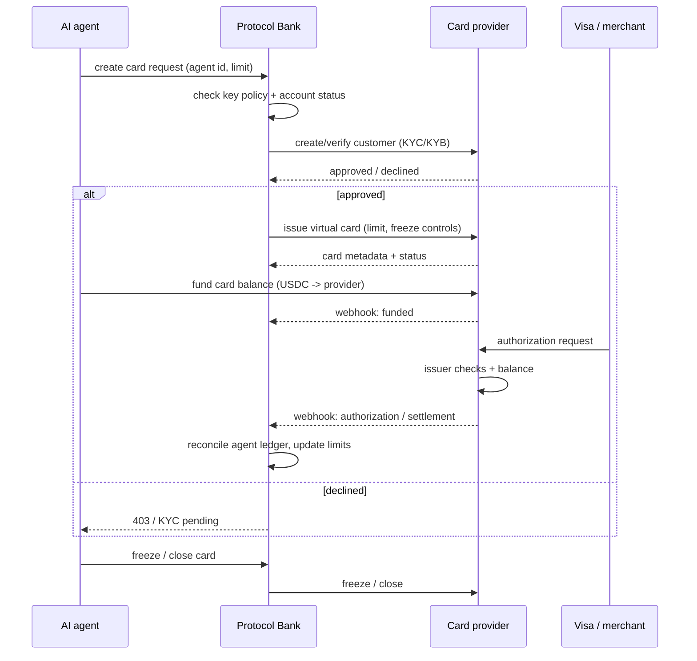

# Card Program Flow

**Version:** 1.0 · **Date:** November 2026

One virtual Visa card per AI agent, funded from a provider-held balance, with
server-enforced limits and freeze/close. The platform does not custody user
crypto or card funds.

---

## 1. Actors

| Actor | Role |
|---|---|
| User / account owner | Creates agents, funds the program, sets limits |
| AI agent | Holds a scoped API key; requests a card and spends within policy |
| Protocol Bank | Policy layer: KYC gate, limits, audit trail, card controls |
| Card provider (Yativo / Rain) | KYC/KYB, card issuance, balance custody, Visa authorization, webhooks |
| Visa network / merchant | Authorization and settlement |

## 2. Program models

### A. Treasury-funded (initial Yativo model)

1. The account owner deposits USDC from the platform treasury to the provider.
2. The provider credits a USD card balance.
3. Each agent gets a virtual card with its own limit.
4. The provider authorizes transactions against the shared/provider balance;
   the platform enforces per-agent limits before the request.
5. The platform reconciles provider webhooks against the agent ledger.

Custody: the provider holds the card balance; the platform holds no user crypto.

### B. Per-user deposit (Rain model)

1. The provider runs KYC per cardholder and issues a per-user deposit contract
   or address.
2. The user/agent funds their own USDC to that address.
3. The card draws from that user's provider-held balance.
4. The platform never holds the funds and stores no PAN/CVC; Rain decrypts card
   data browser-side.

Custody: the provider holds the balance; the user funds it directly.

## 3. End-to-end flow

## 4. Controls before authorization

| Control | Where enforced |
|---|---|
| Allowed operations and caps | Protocol Bank API key policy |
| Per-card limit | Provider card settings + platform policy |
| Velocity / repeated declines | Platform monitoring + provider rules |
| Sanctions / PEP | Provider KYC |
| Freeze / close | Platform control → provider API |
| Balance | Provider ledger; platform reconciles |
| Audit | Platform usage log + provider webhooks |

The platform refuses a card request or spend above the policy before it reaches
the provider. The provider independently applies its own issuer controls.

## 5. Reconciliation

- Provider webhooks: card created, funded, authorization, settlement, decline,
  freeze, close.
- Daily job compares provider balance/transactions with the platform ledger.
- Mismatches are quarantined and reviewed; a card can be frozen while a
  discrepancy is open.
- Errors are surfaced to the account owner; no silent retries of financial
  operations.

## 6. Open questions for the provider

1. KYC ownership: does the provider run end-to-end KYC via API, and for which
   jurisdictions?
2. Deposit model: per-user deposit contract (Rain) or treasury balance (Yativo)?
3. Supported chains and settlement currency.
4. Card limits: per-card, daily, monthly; velocity rules.
5. Webhooks: full event catalogue, retry semantics, signature scheme.
6. PAN/CVC handling: browser-side decryption or provider-hosted iframe; what
   does the platform store?
7. Fees: issuance, top-up, FX, minimum volume.
8. Program agreement: which entity contracts, which regulator, which MLRO owns
   SAR filing?
9. Freeze/close API latency and semantics.
10. Production timeline after KYB approval.

## 7. Current status

- **Yativo:** client implemented (accounts, virtual cards, top-up, withdraw);
  sandbox host returned 522 during the last check; production keys returned 401
  (revoked). Awaiting account/KYB confirmation and reissued keys.
- **Rain:** client + webhook + tests implemented; application pack prepared;
  submission blocked on company KYB documents (registration number, address,
  directors/UBO, bank).
- **Platform:** card policy, freeze controls and provider webhook receiver are in
  the codebase; production activation waits on a provider program.
